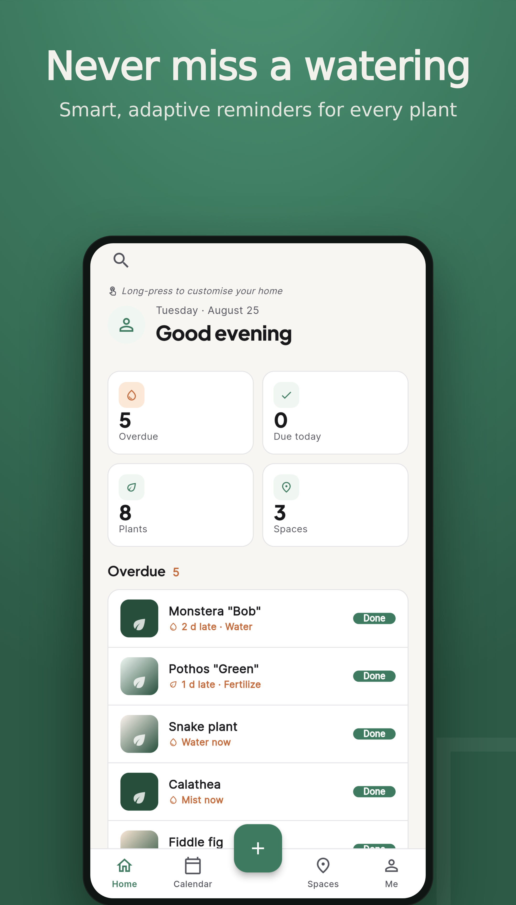
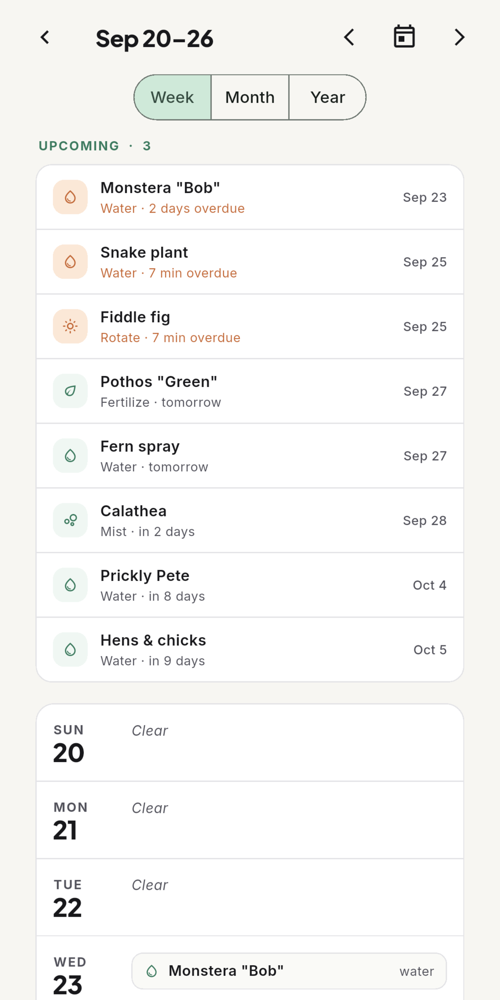
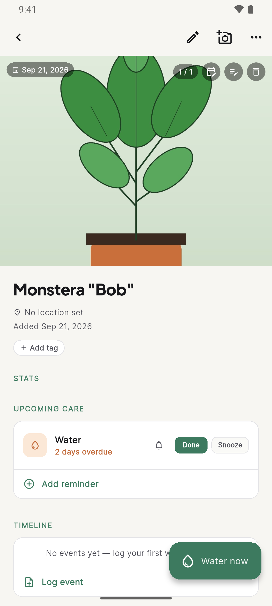
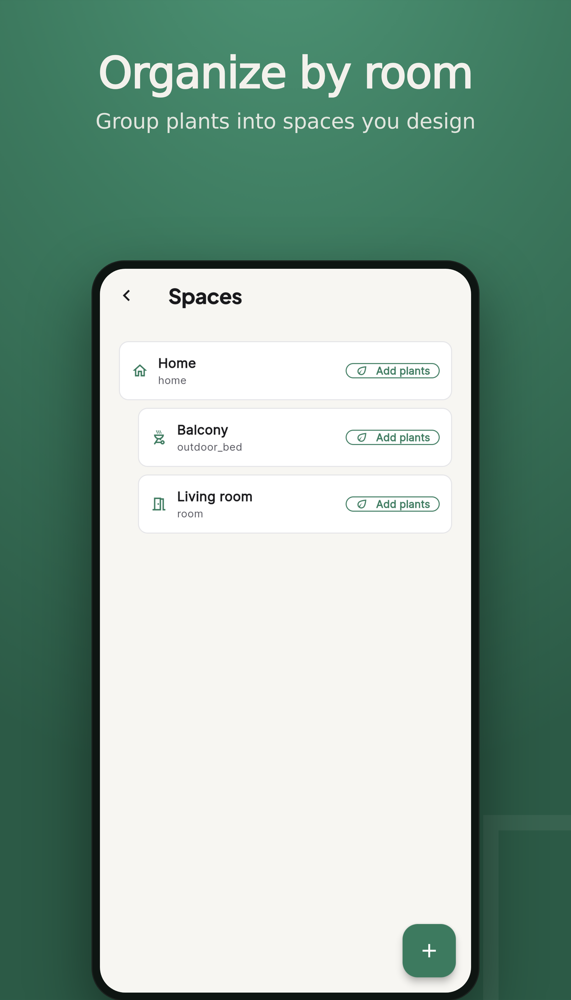
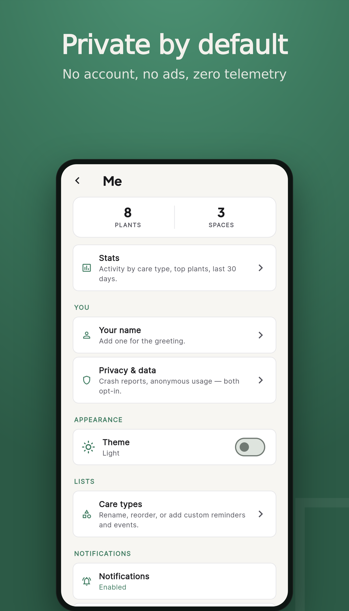

# Plantly Inventory

[](https://github.com/Plantly-ro/plantly-inventory/actions/workflows/ci.yml)
[](./LICENSE)
[](https://play.google.com/store/apps/details?id=ro.plantly.inventory)
[](#development-setup)

> Offline-first, open-source plant care tracker. Logs watering / fertilising / repotting / pruning / photos for the plants you actually own, reminds you when each one needs attention, and — when you decide to sell one — exports it in one click as a listing on [plantly.ro](https://plantly.ro) (or any other marketplace via the plugin system).

- **Android:** [Plantly Inventory on Google Play](https://play.google.com/store/apps/details?id=ro.plantly.inventory) — free, works fully offline, no account needed.
- **Web:** [inventory.plantly.ro](https://inventory.plantly.ro) — the same app in the browser, part of the paid Inventory Cloud service (see below).
- **iOS:** not published yet (the project builds; App Store distribution is pending).
- Languages: English + Romanian.

## Open source, with a paid cloud add-on

This repository is the complete client application, licensed under the **AGPL-3.0-or-later** (see [`LICENSE`](./LICENSE)). You can build it, run it, modify it and redistribute it under the terms of that licence.

**Inventory Cloud** — cross-device sync, cloud backup, shared collections and the browser version — is a paid service operated by URUNDEAD LABS S.R.L. on the plantly.ro backend. The client code for those features is in this repo and compiled in via feature flags, but the service itself is not open source and requires a plantly.ro account with an active subscription. The Android app stays free and local-first; nothing in it requires the cloud.

The *Plantly* name and logo are trademarks and are **not** covered by the AGPL — see [`TRADEMARKS.md`](./TRADEMARKS.md). Forks must rebrand before distribution.

## Screenshots

<p align="center">
  
  
  
  
  
</p>

(Store screenshots from `android/fastlane/metadata/android/`; Romanian versions sit next to them under `ro/`.)

## Features

- Plants, spaces (locations with pins on a photo), species, care types, reminders and a week calendar.
- Full care timeline per plant with photos (compressed on save), propagation, notes.
- Customisable widget-based home (four presets, reorder / add / remove).
- Local notifications via the OS alarm system — no push server.
- Encrypted JSON/ZIP backup and restore, iCal and CSV export.
- Marketplace export plugin: list a plant on plantly.ro from the app (compile-time flag).
- Light + dark themes; phone, tablet and desktop layouts.
- See [`FEATURES.md`](./FEATURES.md) for the full list and [`PLAN.md`](./PLAN.md) for the data model, sync protocol and threat model.

## Privacy

Plantly Inventory is offline-first by design. Plant data, photos, care events and schedules live entirely on your device in a local SQLite database. Nothing is sent to a server unless you explicitly ask for it:

- **Backups** (JSON or ZIP) only leave the device via the share sheet when you tap Export.
- **Notifications** fire locally via the OS alarm system. We do not use a push server.
- **Crash reports** and **anonymous usage analytics** are off by default. The first-run onboarding and the Me → Privacy & data screen let you opt in. Even then, releases from this repository ship with no Sentry DSN configured — so without a forked build that supplies one, no events ever leave the device.
- **plantly.ro export** sends only the fields you review in the Export dialog, never the full database.
- **Inventory Cloud** sync only runs after you sign in and link a collection, and can be switched off without touching local data.

See `lib/features/me/privacy_screen.dart` for the user-facing statement, `lib/services/telemetry.dart` for the consent gating, and the privacy policy in [`docs/privacy-policy.en.md`](docs/privacy-policy.en.md) / [`docs/privacy-policy.ro.md`](docs/privacy-policy.ro.md).

## Development setup

Flutter **3.44.0** (stable) is the pinned toolchain for CI; the lockfile floats only SDK-pinned packages, so a newer local stable usually works (golden tests may drift on a different engine — run them with the pinned version if you touch UI).

```bash
git clone https://github.com/Plantly-ro/plantly-inventory.git
cd plantly-inventory
flutter pub get
flutter run                  # pick a device; `-d chrome` for web
```

- Generated Drift schema (`lib/data/database/*.g.dart`) and localisations (`lib/l10n/generated/`) are committed, so the repo builds without `build_runner`. Regenerate after editing tables or `.arb` files: `dart run build_runner build --delete-conflicting-outputs` / `flutter gen-l10n`.
- Static analysis: `flutter analyze --no-fatal-infos` (warnings and errors fail CI; infos do not).
- Tests: `flutter test --reporter=expanded`. Golden tests live in `test/goldens/`; update with `flutter test --update-goldens test/goldens` using the pinned Flutter version.
- Release tooling tests (stdlib only): `python3 -m unittest discover -s tool/tests`.
- Design prototype (the visual reference for Phase 1): `npm install && npm start` → http://localhost:4173/ ; Playwright e2e for it: `npx playwright install --with-deps chromium && npm test`.

See [`CONTRIBUTING.md`](./CONTRIBUTING.md) for the branch model, PR rules and the CI/release pipeline, and [`CLAUDE.md`](./CLAUDE.md) for the repo map.

### Marketplace integration flags (all targets)

| dart-define | Default | Effect |
|---|---|---|
| `PLANTLY_HOST` | `https://plantly.ro` | Marketplace API + web origin (`/api/v1`). Point at a staging deployment of the marketplace if you run one, e.g. `https://preview.example.com`. |
| `PLANTLY_SELL_ENABLED` | `false` | **"Sell on plantly.ro"** (`plantly_ro` export plugin, marketplace category search, Me → Plantly account). Off = the local draft dialog only, no network from the export path. The Assistant/marketplace **import** link handling (`/#/import?d=…`, `plantlyinventory://import`) is always on. |
| `PLANTLY_CLOUD_ENABLED` | `false` (**always `true` on web**) | Cloud backup & sync (Me → Cloud, collection link, sync runner). Ignored on web — see *Web access gate*. |
| `PLANTLY_PLAY_BILLING_ENABLED` | `false` | Google Play in-app purchase of Inventory Cloud (Android only; irrelevant on web). |
| `PLANTLY_FACEBOOK_LOGIN_ENABLED` | `false` | Shows **"Continue with Facebook"** on the plantly.ro login sheet. Only the entry button is gated: Google + email/password stay, and the OAuth callback/deep link is provider-agnostic. |
| `PLANTLY_APP_VERSION` | `dev` | Version string reported in the User-Agent / `X-Plantly-Client` header; CI stamps the pubspec version. |

```bash
# selling ON against a staging marketplace
flutter build web --release --no-web-resources-cdn \
  --dart-define=PLANTLY_HOST=https://preview.example.com \
  --dart-define=PLANTLY_SELL_ENABLED=true
```

Play Store builds since 1.1.0 ship with `PLANTLY_CLOUD_ENABLED=true` and `PLANTLY_PLAY_BILLING_ENABLED=true`; a plain `flutter build` uses the defaults above (cloud off, sell off).

## Web build

The same app runs in the browser with real persistence:

```bash
flutter build web --release --no-web-resources-cdn   # self-hosts CanvasKit (works under COEP)
python3 -m http.server 8099 --bind 127.0.0.1 --directory build/web
```

- **Database** — Drift on `web/vendor/sqlite3-<ver>/sqlite3.wasm` + `web/vendor/drift-<ver>/drift_worker.js` (pinned to the `sqlite3` / `drift` versions in `pubspec.lock`; re-fetch with `tool/fetch_web_sqlite.sh` after bumping either — new version = new path, see `lib/data/database/web_db_assets.dart`). Storage is OPFS when the page is served with `Cross-Origin-Opener-Policy: same-origin` + `Cross-Origin-Embedder-Policy: require-corp`, IndexedDB otherwise. The two backends are separate stores; drift sticks with whichever one already holds the database, so *adding* the headers later is safe, but *removing* them hides the OPFS data — never remove the headers once shipped.
- **Caching / releases** — Flutter's web file names are not content-hashed, so CI runs `tool/web_version_assets.py build/web <id>` after the build (id unique per build): everything except `index.html`, `version.json`, `manifest.json`, icons, the service-worker stub and `vendor/` moves under `v/<id>/` (`web/prototype/` is dropped), and `web/flutter_bootstrap.js` (custom loader template) loads `main.dart.js`, `assets/` and `canvaskit/` relative to its own URL. Only `index.html` stays mutable (served `no-cache`); `/v/*` and `/vendor/*` are immutable (`tool/web_vendor.sha256` + the fetch scripts refuse to change a recorded vendor path's bytes). A local `flutter build web` without that step still works unversioned.
- **No third-party font requests** — the web engine's default Roboto is bundled (`assets/fonts/Roboto-Regular.ttf`), and glyph-fallback fonts (emoji, symbols, extra Latin/Greek/Cyrillic) are self-hosted under `web/vendor/fallback-fonts/` (`tool/fetch_web_fallback_fonts.sh`); scripts not mirrored (CJK, …) render as tofu instead of calling Google.
- **Photos** — bytes live in IndexedDB (`plantly_inventory_photos`), content-addressed by sha256 like the on-disk store.
- **Backup / iCal / CSV export** — browser download instead of the OS share sheet. Import uses the browser file picker.
- **Not available on web** — scheduled OS notifications (the Me screen and onboarding say so; in-app reminders and the calendar still work) and image re-compression (the picker already downsizes to 1600px).

### Web access gate (subscription-only web)

The browser build is the **Inventory Cloud surface**: using it needs a plantly.ro account with an active `inventory_cloud` entitlement (own plan or included in Plantly Pro). Android stays free and local-first; only web is gated.

- `PlantlyFeatures.cloudEnabled` is **forced on when `kIsWeb`** — the `PLANTLY_CLOUD_ENABLED` define is ignored on web (still honoured on Android/iOS/desktop).
- `lib/cloud/web_access.dart` derives `webAccessProvider` (`checking` / `closedSignedOut` / `closedNotEntitled` / `closedUnreachable` / `open`) from the session + entitlement providers; the router (`lib/app/router.dart`, top-level `redirect`) sends every route to `/gate` (`lib/features/gate/web_access_gate.dart`) while closed — except `/auth/callback`, `/join` and `/import`, whose payloads `HandoffListener` parks — and resumes the parked URL once it opens. Off web the provider is always `open`.
- Re-checks: on sign-in, every 15 min, on tab focus / visibility (if the last check is > 1 min old) and via the gate's "I already subscribed — check again". A lapse returns to the gate **without touching local data**.
- Offline: an entitled check cached ≤ 24 h keeps the app usable with a "no connection" banner; older / none → the gate with a retry. 401/403 never open it.
- The subscribe CTA points at `<PLANTLY_HOST>/account/subscription?product=inventory_cloud`; prices come from `GET /api/v1/subscriptions/plans?product=inventory_cloud` (fixed EUR copy when that fails). The Android card uses the official Play badges bundled in `assets/badges/` (RO + EN, unmodified).
- `web/index.html` carries `<meta name="robots" content="noindex">`: the app is not a landing page (that is `plantly.ro/app/inventory`).

## Release (Android / Google Play)

Official builds are published by the maintainers; contributors never need signing material. Two pipelines exist during the GitLab → GitHub migration:

- **GitHub Actions** — `.github/workflows/release.yml` (`workflow_dispatch`, or a `v*` tag). Builds a signed AAB and uploads it to the chosen Play track via `tool/play_upload.py`, behind the `play-release` environment (required reviewers). Secrets and variables it expects are listed in [`CONTRIBUTING.md`](./CONTRIBUTING.md#release-pipeline-maintainers).
- **GitLab CI** (legacy, `.gitlab-ci.yml`) — `publish-internal` / `publish-production` / `publish-listing`, click-gated manual jobs. Kept until the migration is complete.

Common to both:

- `versionCode` must be globally increasing across **both** tracks (production 1.0.0 = 2882). GitLab used the pipeline id; GitHub uses `PLAY_VERSION_CODE_BASE + run_number` (see CONTRIBUTING). `versionName` = `version:` in `pubspec.yaml` unless the job overrides it (internal builds use `<version>-internal.<n>`).
- Compile-time flags: both tracks ship `--dart-define=PLANTLY_CLOUD_ENABLED=true --dart-define=PLANTLY_PLAY_BILLING_ENABLED=true` (the app itself stays free; Inventory Cloud is the paid add-on bought in-app via Play Billing, included in Plantly Pro).
- Release notes: `changelogs/default.txt` applies to every build; add `changelogs/<versionCode>.txt` to override for one build (≤500 chars). The internal track reads `android/fastlane/metadata/internal/` instead of the store-listing tree (`android/fastlane/metadata/android/`); `lint-tools` validates both on every push.
- Scripts: `tool/play_listing.py` (store listing; `--dry-run` validates without credentials) and `tool/play_upload.py` (AAB + deobfuscation files + track; `--rollout-update` edits a staged rollout). Tests: `python3 -m unittest discover -s tool/tests`.
- Deobfuscation: release builds are R8-minified, so `play_upload.py` attaches the R8 mapping (`build/app/outputs/mapping/release/mapping.txt`) to the uploaded versionCode in the same edit — CI passes `--mapping` explicitly so a missing mapping fails the job; the mapping is also kept as a build artifact next to the AAB. Native debug symbols (`--native-symbols`) are auto-detected. `--mapping none` / `--native-symbols none` skip either.
- Store metadata layout and console-only items: [`android/fastlane/README.md`](android/fastlane/README.md), [`docs/play-console-checklist.md`](docs/play-console-checklist.md).

### Staged rollout (production)

Production ships as a staged rollout (`--rollout 0.2` → `status: inProgress`, `userFraction 0.2`). Play serves the new versionCode to 20 % of users; everyone else keeps the previous release until the rollout is widened. Without a rebuild:

```bash
SA=/path/to/play-service-account.json
python3 tool/play_upload.py --package ro.plantly.inventory --credentials "$SA" --track production --rollout-update 0.5       # widen to 50 %
python3 tool/play_upload.py --package ro.plantly.inventory --credentials "$SA" --track production --rollout-update complete  # 100 %
```

The script opens an edit, takes the track's single `inProgress` release (or `--version-code <id>` when there are several), rewrites `userFraction` / `status` and commits; lowering a fraction is refused (halt from Play Console instead). Equivalent by hand: Play Console → *Production → Releases → Manage rollout*. Python deps: `google-api-python-client google-auth google-auth-httplib2`.

### Internal testing (Inventory Cloud + in-app subscription)

The internal track builds with the same flags as production and is where a release is exercised with licence-tester (free) purchases before production is published.

1. Run the release workflow with `track=internal` (or the legacy `publish-internal` job). The log ends with `committed: ro.plantly.inventory versionCode <id> -> internal (completed)`; the AAB + R8 mapping are kept as artifacts.
2. Play Console → *Testing → Internal testing* shows the release within a few minutes (no review for internal releases).
3. **Who can install** — only accounts on the internal testers list (Play Console → *Testing → Internal testing → Testers*, max 100). The same accounts should be on *Monetise → Monetisation setup → Licence testing* so purchases are test purchases.
4. **Opt-in link** — *Testing → Internal testing → Testers → How testers join your test → Copy link* (`https://play.google.com/apps/internaltest/<id>`). Each tester opens it once, taps *Become a tester*, then installs **Plantly Inventory** from the Play Store (a sideloaded build of the same package must be uninstalled first).
5. **Test-purchase flow** (licence testers are never charged; Play test subscriptions renew on a compressed clock and auto-cancel after a few renewals): *Me → Plantly account* → sign in; *Me → Cloud* shows the Play plan picker (product `inventory_cloud`, base plans `monthly` / `yearly`). Pick a plan → the Play sheet must say **"Test card, always approves"**. The app sends the purchase token to the marketplace, which verifies it with Play and grants the entitlement (visible under `/me/cloud`, provider **play**, and on plantly.ro → `/account/subscription`). Sync: link a collection, change a plant, confirm it appears on `https://inventory.plantly.ro`. Cancel from *Manage subscription* or wait for the test auto-cancel; the entitlement lapses on the next re-check and the app falls back to local-only without touching local data.

### Local release signing

Release builds are signed with a keystore referenced via `android/key.properties`. That file is **not committed** — copy `android/key.properties.example` and fill in your own values, then run:

```bash
flutter build appbundle --release     # or: flutter build apk --split-per-abi --release
```

Without `key.properties`, the release build falls back to the Flutter debug keystore so `flutter run --release` still works on contributor machines. Details: https://docs.flutter.dev/deployment/android#signing-the-app

## Release (Web / inventory.plantly.ro)

The Flutter **web** build is deployed as static files behind the plantly.ro reverse proxy at `https://inventory.plantly.ro`. CI's `build-web` job produces the artifact on every branch (`flutter build web --release --no-web-resources-cdn --dart-define=PLANTLY_APP_VERSION=<pubspec version> $INVENTORY_WEB_DART_DEFINES` → `build/web/`, then `tool/web_version_assets.py`); the deploy itself (`ci/prod/deploy-web.sh`, GitLab `deploy-web-prod` on `main`) is operated by the maintainers and needs host access that is not part of this repo.

- `INVENTORY_WEB_DART_DEFINES` (optional CI variable): extra space-separated `--dart-define=K=V` flags for `build-web`. Unset = compile-time defaults.
- The web app calls plantly.ro's API cross-origin, so `https://inventory.plantly.ro` must be in the marketplace's allowed origins.
- Prod is a curated release line: ship via a `Promote:` PR `development` → `main`.

## Contributing, security, conduct

- [`CONTRIBUTING.md`](./CONTRIBUTING.md) — how to set up, test and submit changes (English or Romanian welcome).
- [`SECURITY.md`](./SECURITY.md) — how to report a vulnerability privately.
- [`CODE_OF_CONDUCT.md`](./CODE_OF_CONDUCT.md) — Contributor Covenant 2.1.
- [`TRADEMARKS.md`](./TRADEMARKS.md) — use of the Plantly name and logo.

## Licence

- **App + prototype:** AGPL-3.0-or-later (see [`LICENSE`](./LICENSE)).
- **Plugin SDK + generated Dart API client:** MIT.
- **Species seed data:** CC-BY-SA-4.0.
- **Plantly name, logo and store assets:** trademarks of URUNDEAD LABS S.R.L., not licensed — see [`TRADEMARKS.md`](./TRADEMARKS.md).

## Related

- Marketplace: [plantly.ro](https://plantly.ro) — the plant marketplace this app exports to and whose account powers Inventory Cloud.
- App landing page: https://plantly.ro/app/inventory
